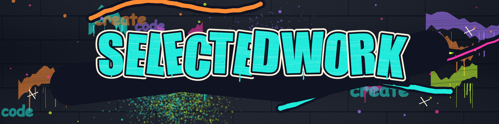
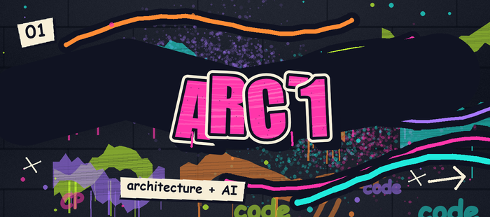
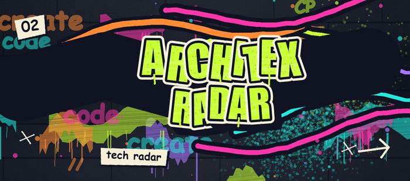
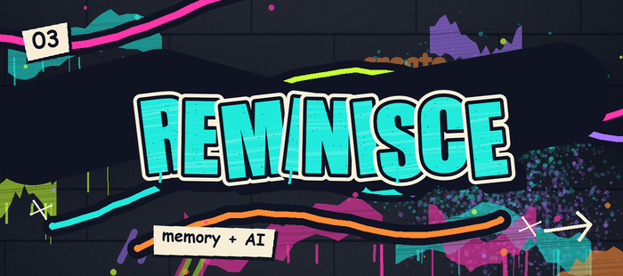
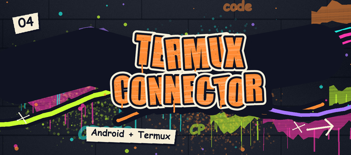
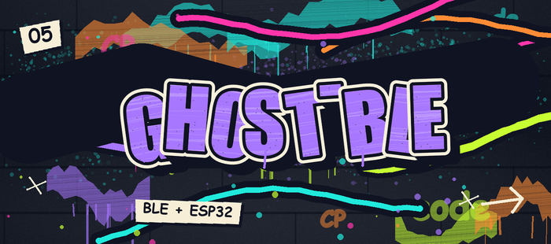
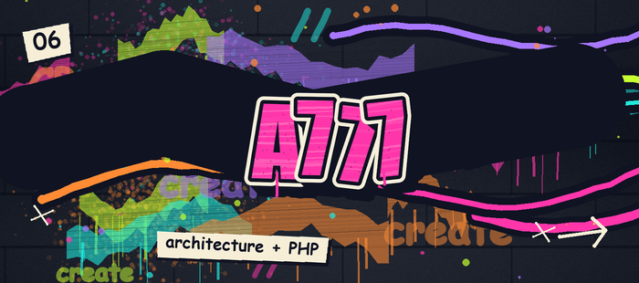
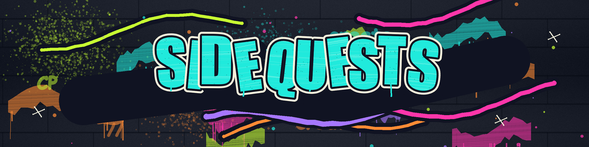
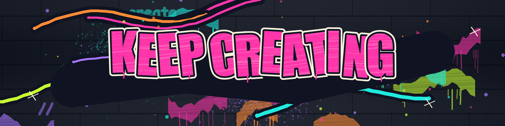

  
   
  <strong>BUILD / BREAK / REBUILD</strong> 
  ARCHITECTURE • AI • MOBILE • SIGNALS  
  <a href="https://github.com/cp-coder9?tab=repositories">EXPLORE ALL REPOSITORIES ↗</a>

 

Public GitHub counts • updated daily

  

  
  
  
  
  
  

 

<strong>OPEN THE CRATE ↓</strong>

 

- **[Nebula Scribe](https://github.com/cp-coder9/Nebula-Scribe-)** — voice transcription for noisy environments.
- **[Wigglefish](https://github.com/cp-coder9/wigglefish)** — a fork of a passive Wi-Fi/BLE field scanner.
- **[Kiro Gateway](https://github.com/cp-coder9/kiro-gateway)** — a Kiro API proxy gateway; its README credits [Jwadow](https://github.com/jwadow).
- **[All public repositories](https://github.com/cp-coder9?tab=repositories)** — explore the full collection.

 

  

