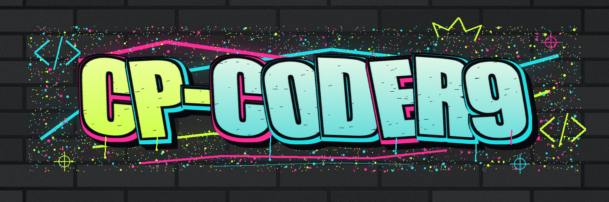
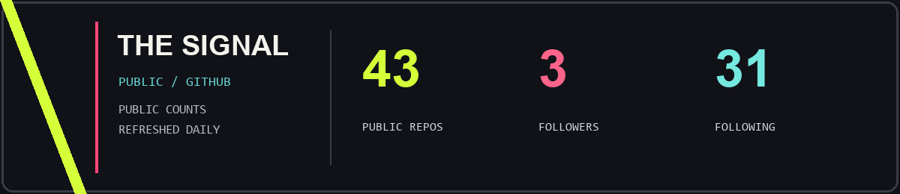
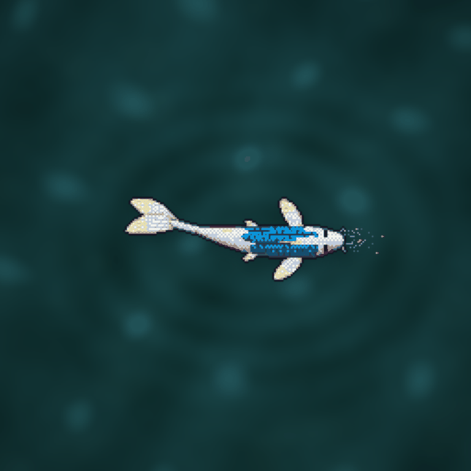

  
   
  <strong>BUILD / BREAK / REBUILD</strong>
   
  ARCHITECTURE  •  AI  •  MOBILE  •  SIGNALS
    
  <a href="#the-signal">THE SIGNAL</a> &nbsp; / &nbsp;
  <a href="#the-work">THE WORK</a> &nbsp; / &nbsp;
  <a href="https://github.com/cp-coder9?tab=repositories">ALL REPOS ↗</a>

---

## THE SIGNAL

Public GitHub counts • refreshed alongside the koi • no tracking pixels

## THE WORK

A few stops on the wall. Explore the repositories for the actual code, documentation and project status.

<table>
<tr>
<td width="50%">
<strong><a href="https://github.com/cp-coder9/arc-1">01 / ARC-1 ↗</a></strong> 
Architectural AI compliance marketplace.  
<code>ARCHITECTURE</code> <code>AI</code>
</td>
<td width="50%">
<strong><a href="https://github.com/cp-coder9/architex-technology-radar">02 / ARCHITEX RADAR ↗</a></strong> 
A source-backed static technology radar artifact.  
<code>BUILT ENVIRONMENT</code> <code>RADAR</code>
</td>
</tr>
<tr>
<td width="50%">
<strong><a href="https://github.com/cp-coder9/Reminisce">03 / REMINISCE ↗</a></strong> 
A memory AI app.  
<code>AI</code> <code>MEMORY</code>
</td>
<td width="50%">
<strong><a href="https://github.com/cp-coder9/termux-connector">04 / TERMUX CONNECTOR ↗</a></strong> 
An Android app and Python server connecting to Termux over TCP.  
<code>ANDROID</code> <code>PYTHON</code>
</td>
</tr>
</table>

<strong>MORE FROM THE UNDERGROUND &nbsp; ↓</strong>

 

- **[Nebula Scribe](https://github.com/cp-coder9/Nebula-Scribe-)** — voice transcription for noisy environments.
- **[Wigglefish](https://github.com/cp-coder9/wigglefish)** — a fork of a passive Wi-Fi/BLE field scanner.
- **[Kiro Gateway](https://github.com/cp-coder9/kiro-gateway)** — a Kiro API proxy gateway.
- **[All public repositories](https://github.com/cp-coder9?tab=repositories)** — explore the full collection.

---

  

  CP-CODER9 &nbsp; / &nbsp; KEEP MAKING THINGS

